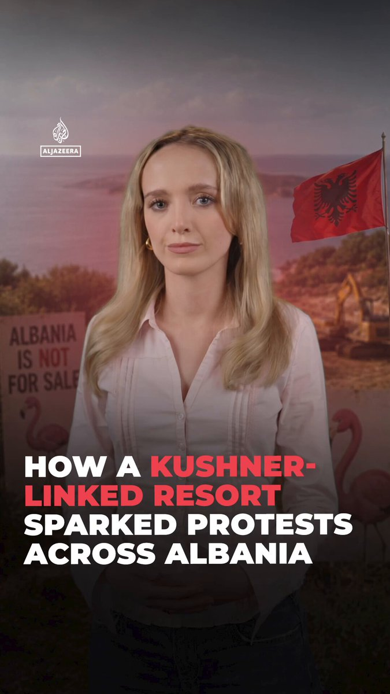
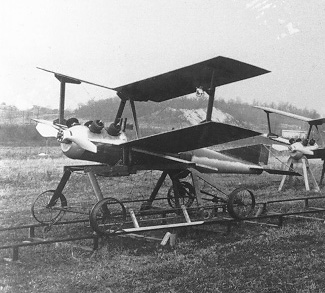
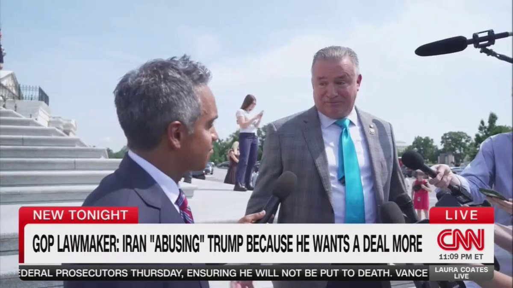
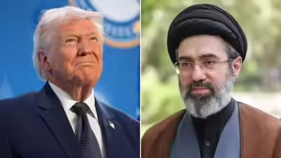
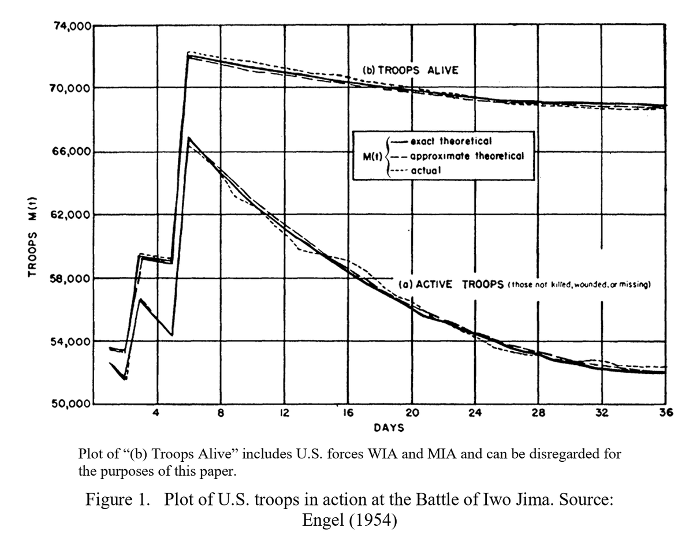
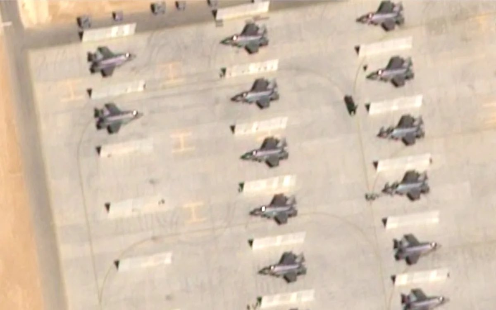
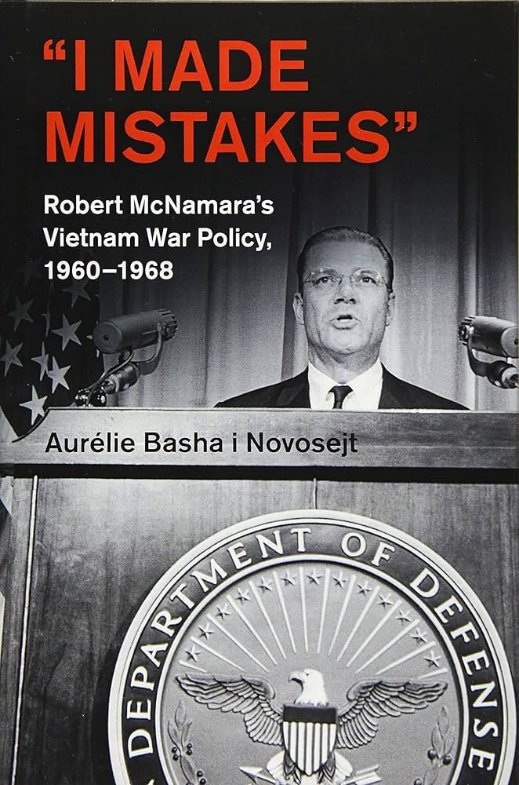
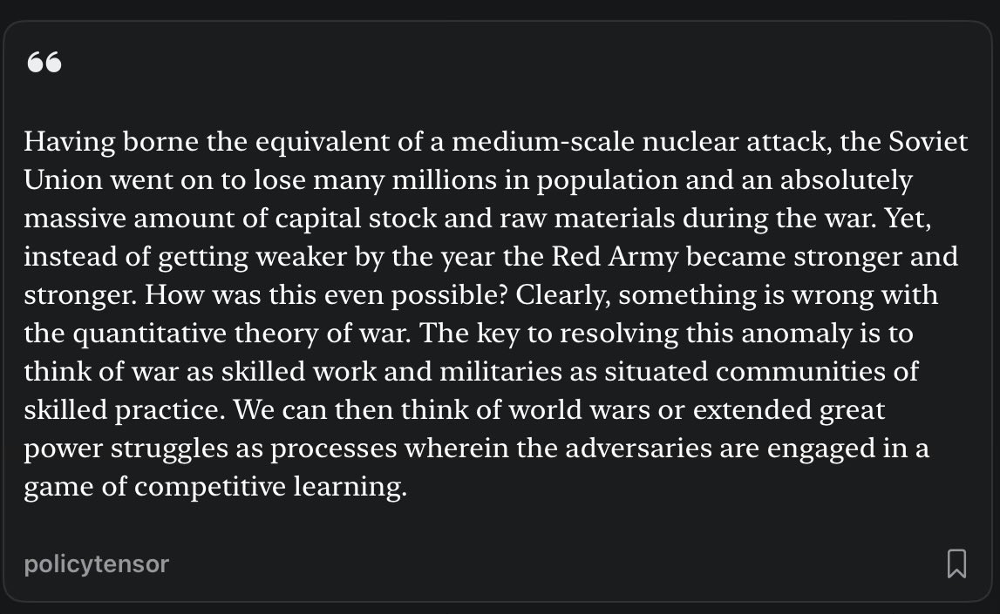
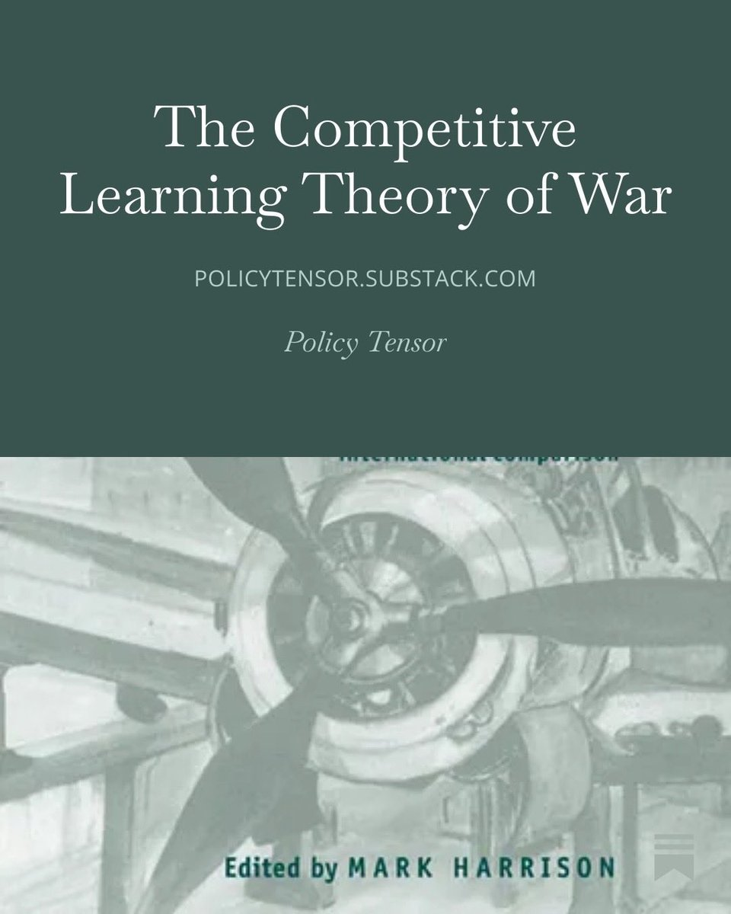

# Twitter Timeline Export

## Entry 1
### Policy Tensor
- Username: @policytensor
- Tweet ID: `2064280559702909010`
- Date: [2026-06-09 09:36 UTC](https://x.com/policytensor/status/2064280559702909010)

An Equilibrium Model of Counter-Base War in the Western Pacific, by @policytensor https://t.co/DOAYbvr7zF https://t.co/MoVdZY0mmL

---

## Entry 2
### Policy Tensor
- Username: @policytensor
- Tweet ID: `2065326315805217233`
- Date: [2026-06-12 06:52 UTC](https://x.com/policytensor/status/2065326315805217233)

The anxiety will go away once we fully commit to the suicidal policy of fighting China.

**Quoted Forward:**
> ### Bonnie Glaser / 葛來儀
> - Username: @BonnieGlaser
> - Tweet ID: `2065204332400963881`
> - Date: [2026-06-11 22:47 UTC](https://x.com/BonnieGlaser/status/2065204332400963881)
> 
> “Based on the sum total of what President Trump has said to the media, it seems like he has absorbed a great deal of Xi Jinping’s thinking on Taiwan,” said Bonnie S. Glaser, the managing director of the Indo-Pacific program at the German Marshall Fund. “People are anxious.”
> 

---

## Entry 3
### Policy Tensor
- Username: @policytensor
- Tweet ID: `2065314119553515952`
- Date: [2026-06-12 06:03 UTC](https://x.com/policytensor/status/2065314119553515952)

Credentialist bullshit. Why don't you make an actual point? This is not admissible.

**Quoted Forward:**
> ### Jason Kerwin
> - Username: @jt_kerwin
> - Tweet ID: `2064962290894667854`
> - Date: [2026-06-11 06:45 UTC](https://x.com/jt_kerwin/status/2064962290894667854)
> 
> Periodic reminder that Jason Hickel has a PhD in anthropology, and there is no evidence that he has ever taken an economics course in his life https://t.co/cUit3rfzHt
> 
> 
> 

---

## Entry 4
### Policy Tensor
- Username: @policytensor
- Tweet ID: `2065313794339836196`
- Date: [2026-06-12 06:02 UTC](https://x.com/policytensor/status/2065313794339836196)

RT @DropSiteNews: 🇦🇱 Albania’s “Flamingo Revolution” escalated Thursday, with protests against the roughly €5 billion luxury Jared Kushner…

**Reposted:**
> ### Drop Site
> - Username: @DropSiteNews
> - Tweet ID: `2065278888276537823`
> - Date: [2026-06-12 03:43 UTC](https://x.com/DropSiteNews/status/2065278888276537823)
> 
> 🇦🇱 Albania’s “Flamingo Revolution” escalated Thursday, with protests against the roughly €5 billion luxury Jared Kushner and Ivanka Trump backed resort expanding into demands for the entire political establishment to step aside, Bloomberg reported.
> 
> Now in their second week, the
> 
> **Quoted Forward:**
> > ### Al Jazeera English
> > - Username: @AJEnglish
> > - Tweet ID: `2065157421803212887`
> > - Date: [2026-06-11 19:41 UTC](https://x.com/AJEnglish/status/2065157421803212887)
> > 
> > A luxury resort linked to Donald Trump’s son-in-law Jared Kushner has sparked some of the biggest protests Albania has seen in years.
> > 
> > Al Jazeera's Ava Warriner explains why the project has become one of Albania's most divisive political issues. https://t.co/j8TIUzETth
> > 
> > 
> > 

---

## Entry 5
### Policy Tensor
- Username: @policytensor
- Tweet ID: `2065312671549866492`
- Date: [2026-06-12 05:58 UTC](https://x.com/policytensor/status/2065312671549866492)

$50 billion? $100 billion? How much did Abu Dhabi agree to pay Tehran?

**Quoted Forward:**
> ### Drop Site
> - Username: @DropSiteNews
> - Tweet ID: `2065304108957909330`
> - Date: [2026-06-12 05:24 UTC](https://x.com/DropSiteNews/status/2065304108957909330)
> 
> 🇦🇪🇮🇷 UAE, Iran Security Officials Hold First Face-to-Face Talks Since War
> 
> Senior national security officials from the United Arab Emirates and Iran met in person this week for the first time since the U.S.-Israeli war on Iran began in late February, Bloomberg reported, in what
> 

---

## Entry 6
### Policy Tensor
- Username: @policytensor
- Tweet ID: `2065302160431067329`
- Date: [2026-06-12 05:16 UTC](https://x.com/policytensor/status/2065302160431067329)

Had not realized the first drones flew in the Great War. Meet the Kettering Bug from 1918! https://t.co/Xw25BOMV5W

---

## Entry 7
### Policy Tensor
- Username: @policytensor
- Tweet ID: `2065299487984165373`
- Date: [2026-06-12 05:05 UTC](https://x.com/policytensor/status/2065299487984165373)

A very bold call by @ProfessorPape.

**Quoted Forward:**
> ### Acyn
> - Username: @Acyn
> - Tweet ID: `2065272518962020712`
> - Date: [2026-06-12 03:18 UTC](https://x.com/Acyn/status/2065272518962020712)
> 
> Pape: We're about to enter the period of maximum leverage for Iran. When we hit the oil inventory cliff, as we're going to do in the middle of July, end of July, that means when our inventories go down, Iran's leverage goes up and will stay up through the midterms. 
> 
> So that is https://t.co/mAiibRq6An
> 
> 
> 

---

## Entry 8
### Policy Tensor
- Username: @policytensor
- Tweet ID: `2065298484136165651`
- Date: [2026-06-12 05:01 UTC](https://x.com/policytensor/status/2065298484136165651)

I recall that Saddam had demanded $10 billion from Kuwait in 1990. The Saudis got it done. But he invaded anyway after he thought he had the green light from the US ambassador. 

April Glaspie had been instructed to signal that the US would tolerate an Iraqi conquest of two https://t.co/J7JqUKizeA

**Quoted Forward:**
> ### Policy Tensor
> - Username: @policytensor
> - Tweet ID: `2065218940100284826`
> - Date: [2026-06-11 23:45 UTC](https://x.com/policytensor/status/2065218940100284826)
> 
> Are the Saudis and Emiratis paying Iran for protection as Pape suggests?
> 

---

## Entry 9
### Policy Tensor
- Username: @policytensor
- Tweet ID: `2065295530612105441`
- Date: [2026-06-12 04:50 UTC](https://x.com/policytensor/status/2065295530612105441)

Wait for Tehran.

**Quoted Forward:**
> ### Sulaiman Ahmed
> - Username: @ShaykhSulaiman
> - Tweet ID: `2065288528909443087`
> - Date: [2026-06-12 04:22 UTC](https://x.com/ShaykhSulaiman/status/2065288528909443087)
> 
> U.S-IRAN CEASEFIRE DEAL BREAKDOWN
> 
> NUCLEAR
> ✅ Iran commits to never acquire a nuclear weapon 
> ✅ Iran be open to down-blending their highly enriched uranium inside Iran under supervision of UN inspectors.
> ✅ Steps on Iran's nuclear program would only take place if a second deal https://t.co/wl2T8XitF0
> 
> 
> 

---

## Entry 10
### Policy Tensor
- Username: @policytensor
- Tweet ID: `2065295103707513322`
- Date: [2026-06-12 04:48 UTC](https://x.com/policytensor/status/2065295103707513322)

Engel (1954)’s verification of Lanchester’s square law using data from the Battle of Iwo Jima. https://t.co/q9PitX1cKz

---

## Entry 11
### Policy Tensor
- Username: @policytensor
- Tweet ID: `2065268579717579151`
- Date: [2026-06-12 03:02 UTC](https://x.com/policytensor/status/2065268579717579151)

One of the things we’ve learnt is that practically the entire region around Iran is one giant air field for the eagles.

**Quoted Forward:**
> ### Aᴍɪʀ
> - Username: @AmirIGM
> - Tweet ID: `2065110161098744141`
> - Date: [2026-06-11 16:33 UTC](https://x.com/AmirIGM/status/2065110161098744141)
> 
> Poor innocent Jordan just days before the Americans and Zios launched their war of aggression on Iran: 
> 
> Dozens of American F-15s and F-35s were moved to Jordan in February and were used in the attack against Iran. https://t.co/Vql4inQzwu
> 
> 
> 

---

## Entry 12
### Policy Tensor
- Username: @policytensor
- Tweet ID: `2065267243076771953`
- Date: [2026-06-12 02:57 UTC](https://x.com/policytensor/status/2065267243076771953)

Every single security principal in the Kennedy-Johnson administrations was practically handpicked by JFK.

**Quoted Forward:**
> ### Sami Gold
> - Username: @souljagoyteller
> - Tweet ID: `2065247639654871156`
> - Date: [2026-06-12 01:39 UTC](https://x.com/souljagoyteller/status/2065247639654871156)
> 
> Reading this book for class and the fact that anyone believes that JFK would've pulled out of Vietnam if he hadn't been shot is hilarious https://t.co/aT3fVq1F34
> 
> 
> 

---

## Entry 13
### Policy Tensor
- Username: @policytensor
- Tweet ID: `2065265819018199120`
- Date: [2026-06-12 02:51 UTC](https://x.com/policytensor/status/2065265819018199120)

“Or men might instead simply be so stupid as to expect victory when their military ventures were sure to lead to defeat; when both sides to a war each expect to defeat the other on the battlefield, one of them at least should have studied the problem more carefully.”  — Quester

---

## Entry 14
### Policy Tensor
- Username: @policytensor
- Tweet ID: `2065256163248091191`
- Date: [2026-06-12 02:13 UTC](https://x.com/policytensor/status/2065256163248091191)

Looks like they bagged a radar in Kuwait too.

**Quoted Forward:**
> ### Drop Site
> - Username: @DropSiteNews
> - Tweet ID: `2065249982349812068`
> - Date: [2026-06-12 01:49 UTC](https://x.com/DropSiteNews/status/2065249982349812068)
> 
> 🇮🇷🇰🇼 Kuwait’s Civil Aviation Authority says an Iranian strike targeting radar facilities at Kuwait International Airport earlier Thursday caused injuries and significant damage to equipment linked to air traffic management.
> 
> The announcement follows an earlier IRGC statement
> 

---

## Entry 15
### Policy Tensor
- Username: @policytensor
- Tweet ID: `2065255037580763395`
- Date: [2026-06-12 02:09 UTC](https://x.com/policytensor/status/2065255037580763395)

The social scientific theory generates insurmountable puzzles. Above all, why does the winning side become more powerful after considerable losses in a war of attrition? You can’t resolve this puzzle without grasping war-making as skilled work and extended wars are learning https://t.co/IKLOcmnY5Q

**Quoted Forward:**
> ### Policy Tensor
> - Username: @policytensor
> - Tweet ID: `2065251004291883124`
> - Date: [2026-06-12 01:53 UTC](https://x.com/policytensor/status/2065251004291883124)
> 
> Indeed. https://t.co/PkwFTQK5dS https://t.co/CqPK2Z191W
> 
> 
> 

---

## Entry 16
### Policy Tensor
- Username: @policytensor
- Tweet ID: `2065251004291883124`
- Date: [2026-06-12 01:53 UTC](https://x.com/policytensor/status/2065251004291883124)

Indeed. https://t.co/PkwFTQK5dS https://t.co/CqPK2Z191W

**Quoted Forward:**
> ### Balazs Jarabik
> - Username: @BalazsJarabik
> - Tweet ID: `2065058359095558528`
> - Date: [2026-06-11 13:07 UTC](https://x.com/BalazsJarabik/status/2065058359095558528)
> 
> 4/ Systems matter more than platforms. Hornet drones, AI-assisted targeting, Starlink connectivity, reconnaissance-strike networks changing Ukraine’s capabilities. Russia adapts too: Rassvet, Rubicon, electronic warfare, mass production. A competition between learning systems.
> 

---

## Entry 17
### Policy Tensor
- Username: @policytensor
- Tweet ID: `2065249633048096857`
- Date: [2026-06-12 01:47 UTC](https://x.com/policytensor/status/2065249633048096857)

RT @HormuzLetter: BREAKING: Iran's Foreign Ministry directly rejects Trump's new claim that "everyone in Iran has approved the deal," inclu…

**Reposted:**
> ### The Hormuz Letter
> - Username: @HormuzLetter
> - Tweet ID: `2065186182946766878`
> - Date: [2026-06-11 21:35 UTC](https://x.com/HormuzLetter/status/2065186182946766878)
> 
> BREAKING: Iran's Foreign Ministry directly rejects Trump's new claim that "everyone in Iran has approved the deal," including the Supreme Leader, saying no one has accepted it, and "no agreement has been reached," per Fars. 
> 
> Any agreement requires the US to "accept every demand"
> 

---

## Entry 18
### Policy Tensor
- Username: @policytensor
- Tweet ID: `2065249476038557754`
- Date: [2026-06-12 01:47 UTC](https://x.com/policytensor/status/2065249476038557754)

He’s just throwing it out there. There is no military case for seizing Kharg.

**Quoted Forward:**
> ### Edward Luce
> - Username: @EdwardGLuce
> - Tweet ID: `2065073352746623167`
> - Date: [2026-06-11 14:07 UTC](https://x.com/EdwardGLuce/status/2065073352746623167)
> 
> What exactly would taking Kharg Island accomplish? It’s nowhere near the strait and would offer Iranians a juicy target. They can export oil overland and via Caspian Sea.
> 

---

## Entry 19
### Policy Tensor
- Username: @policytensor
- Tweet ID: `2065239354021122444`
- Date: [2026-06-12 01:06 UTC](https://x.com/policytensor/status/2065239354021122444)

RT @RKelanic: Peak authoritarianism.

US administration investigating Iran war critic Trita Parsi, says report https://t.co/08TRM9XzlB

**Reposted:**
> ### Rosemary Kelanic
> - Username: @RKelanic
> - Tweet ID: `2065093223089844323`
> - Date: [2026-06-11 15:26 UTC](https://x.com/RKelanic/status/2065093223089844323)
> 
> Peak authoritarianism.
> 
> US administration investigating Iran war critic Trita Parsi, says report https://t.co/08TRM9XzlB
> 

---

## Entry 20
### Policy Tensor
- Username: @policytensor
- Tweet ID: `2065234201163538742`
- Date: [2026-06-12 00:46 UTC](https://x.com/policytensor/status/2065234201163538742)

As always, we wait for confirmation from Tehran.

---
