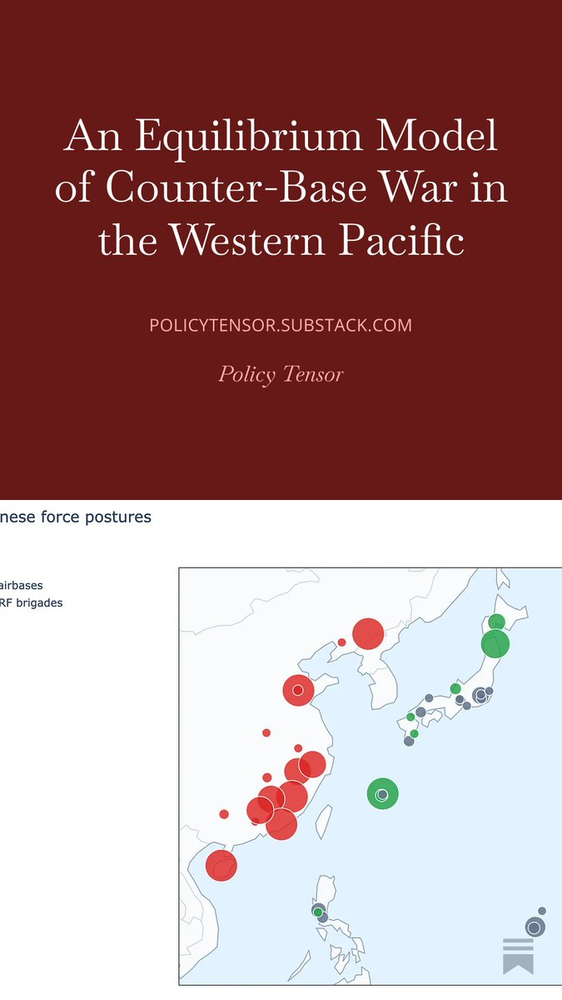
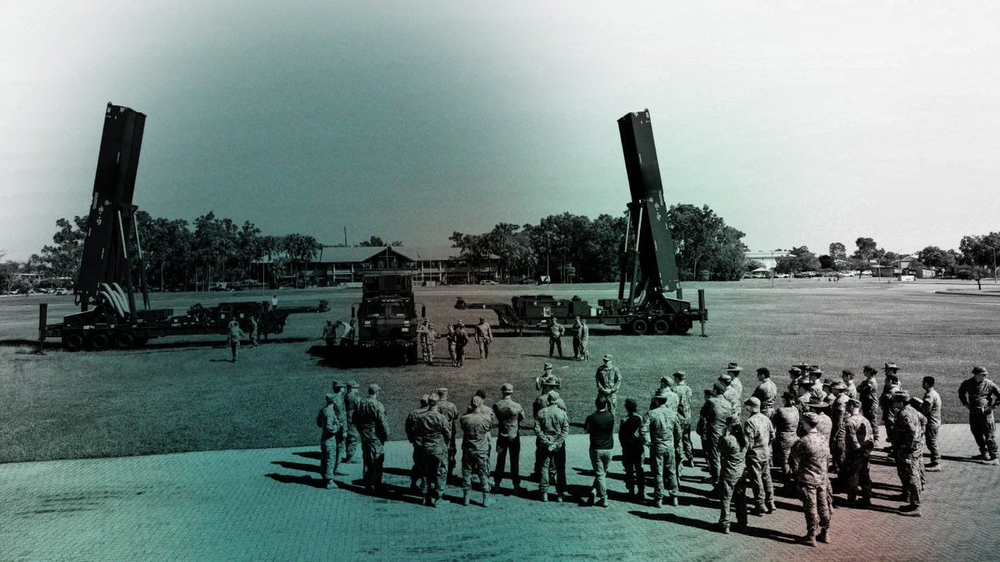
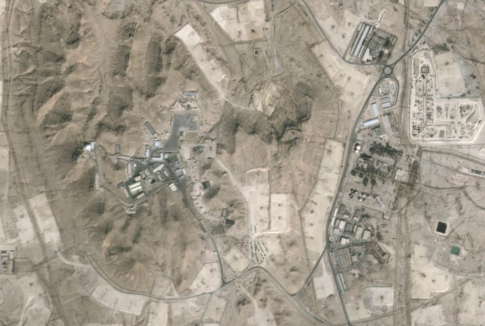
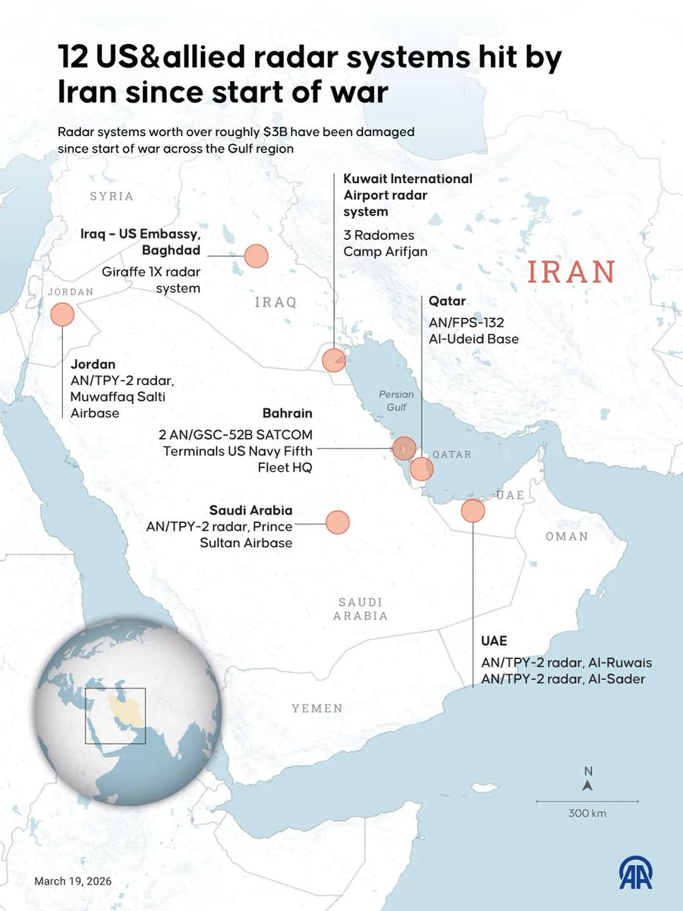
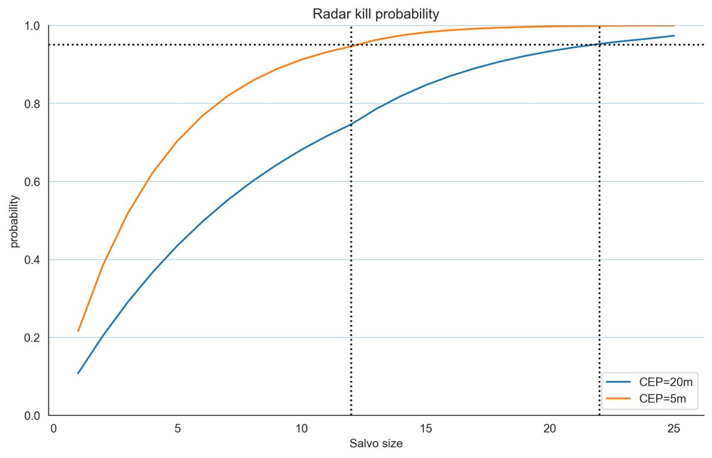
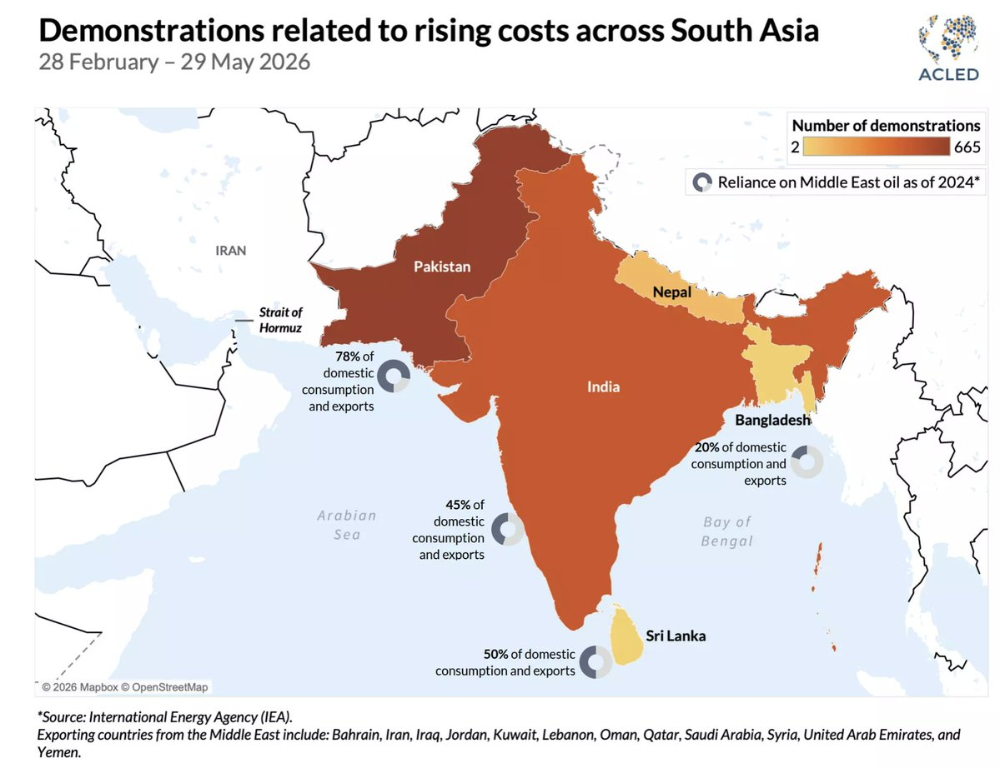
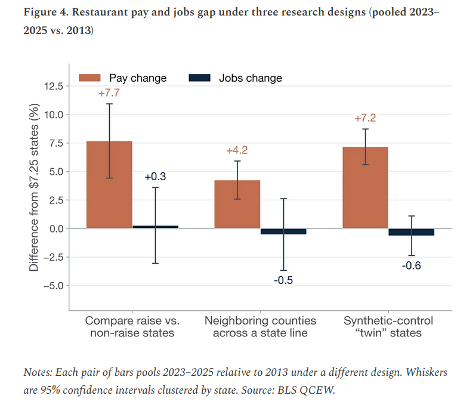
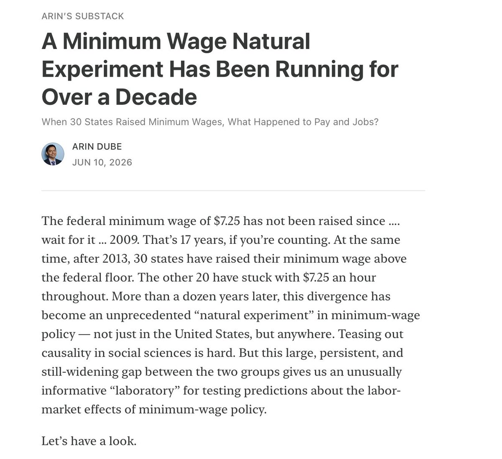
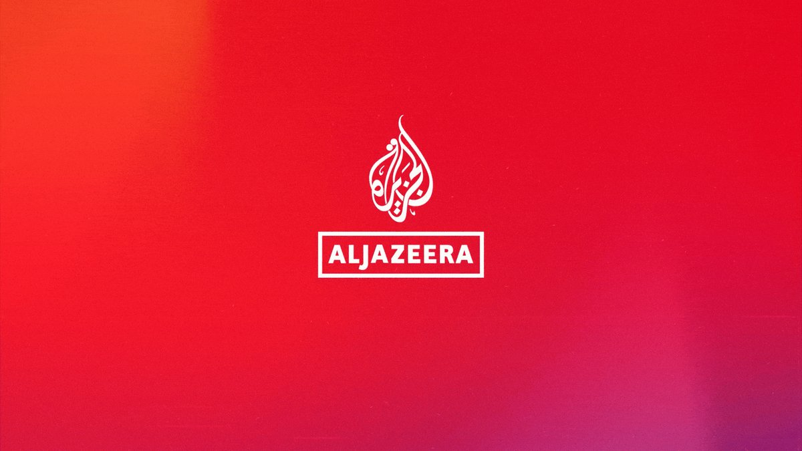

# Twitter Timeline Export

## Entry 1
### Policy Tensor
- Username: @policytensor
- Tweet ID: `2064280559702909010`
- Date: [2026-06-09 09:36 UTC](https://x.com/policytensor/status/2064280559702909010)

An Equilibrium Model of Counter-Base War in the Western Pacific, by @policytensor https://t.co/DOAYbvr7zF https://t.co/MoVdZY0mmL

---

## Entry 2
### Policy Tensor
- Username: @policytensor
- Tweet ID: `2065230898396622987`
- Date: [2026-06-12 00:33 UTC](https://x.com/policytensor/status/2065230898396622987)

Not implausible. But if Iran has to walk back its redline in Lebanon, this would hardly be an unambiguous victory for Iran.

**Quoted Forward:**
> ### Shaiel Ben-Ephraim
> - Username: @academic_la
> - Tweet ID: `2065205873509908774`
> - Date: [2026-06-11 22:53 UTC](https://x.com/academic_la/status/2065205873509908774)
> 
> We are receiving leaks about what is in the agreement and what is out. According to reports this is what is shaping up: 
> 
> What's IN the agreement:
> 
> * 60 days of negotiations on the Iranian nuclear program
> * Strait of Hormuz opens, military operations cease
> * The US lifts its
> 

---

## Entry 3
### Policy Tensor
- Username: @policytensor
- Tweet ID: `2065229988253573477`
- Date: [2026-06-12 00:29 UTC](https://x.com/policytensor/status/2065229988253573477)

RT @sam_lair: I wrote something for @FPRI on CENTCOM's request for Dark Eagle. While not super useful in that theater, the flexibility its…

**Reposted:**
> ### Sam Lair
> - Username: @sam_lair
> - Tweet ID: `2059328555830710521`
> - Date: [2026-05-26 17:39 UTC](https://x.com/sam_lair/status/2059328555830710521)
> 
> I wrote something for @FPRI on CENTCOM's request for Dark Eagle. While not super useful in that theater, the flexibility its range offers means such a deployment could pose issues for Moscow.
> 
> Link below: https://t.co/MfbgPhXiYC
> 
> 
> 

---

## Entry 4
### Policy Tensor
- Username: @policytensor
- Tweet ID: `2065224676972941761`
- Date: [2026-06-12 00:08 UTC](https://x.com/policytensor/status/2065224676972941761)

Good report. https://t.co/vjkbxmkVR2

**Quoted Forward:**
> ### Policy Tensor
> - Username: @policytensor
> - Tweet ID: `2065192166956171365`
> - Date: [2026-06-11 21:59 UTC](https://x.com/policytensor/status/2065192166956171365)
> 
> This is a significant operational achievement for Iran. The AR-327 radar at Bahrain’s highest point is a very important piece of the regional missile defense and battlefield awareness architecture. What you need to realize to see the significance of this hit is this: 
> 
> Radars are https://t.co/9YaBfaIMyW
> 
> 
> 
> 
> 

---

## Entry 5
### Policy Tensor
- Username: @policytensor
- Tweet ID: `2065218940100284826`
- Date: [2026-06-11 23:45 UTC](https://x.com/policytensor/status/2065218940100284826)

Are the Saudis and Emiratis paying Iran for protection as Pape suggests?

---

## Entry 6
### Policy Tensor
- Username: @policytensor
- Tweet ID: `2065192166956171365`
- Date: [2026-06-11 21:59 UTC](https://x.com/policytensor/status/2065192166956171365)

This is a significant operational achievement for Iran. The AR-327 radar at Bahrain’s highest point is a very important piece of the regional missile defense and battlefield awareness architecture. What you need to realize to see the significance of this hit is this: 

Radars are https://t.co/9YaBfaIMyW

**Quoted Forward:**
> ### Drop Site
> - Username: @DropSiteNews
> - Tweet ID: `2065127514146807900`
> - Date: [2026-06-11 17:42 UTC](https://x.com/DropSiteNews/status/2065127514146807900)
> 
> In Bahrain, the Iranian military said it struck communications antennas and radar facilities associated with the U.S. Fifth Fleet’s Patriot air defense network. Open-source analysts have geolocated images of the strike to the Jabal al-Dukhan (translated as the "Mountain of
> 

---

## Entry 7
### Policy Tensor
- Username: @policytensor
- Tweet ID: `2065216636160765960`
- Date: [2026-06-11 23:36 UTC](https://x.com/policytensor/status/2065216636160765960)

We may find out that they hit a radar in Jordan too.

---

## Entry 8
### Policy Tensor
- Username: @policytensor
- Tweet ID: `2065216113906942296`
- Date: [2026-06-11 23:34 UTC](https://x.com/policytensor/status/2065216113906942296)

Inventory cliff coming end of July, Pape says.

---

## Entry 9
### Policy Tensor
- Username: @policytensor
- Tweet ID: `2065213876308672758`
- Date: [2026-06-11 23:25 UTC](https://x.com/policytensor/status/2065213876308672758)

He thinks Iran needs a month to make 11-16 nukes. 👀

---

## Entry 10
### Policy Tensor
- Username: @policytensor
- Tweet ID: `2065212136242966534`
- Date: [2026-06-11 23:18 UTC](https://x.com/policytensor/status/2065212136242966534)

My respect for Pape has increased considerably. Watching his show. He’s saying that Iran has good reasons to kick the can down the road.

Indeed. Time is Iran’s great power ally. The US is racing against time. There is only so long the Chinese can bail the US out.

**Quoted Forward:**
> ### Policy Tensor
> - Username: @policytensor
> - Tweet ID: `2064769783074037768`
> - Date: [2026-06-10 18:00 UTC](https://x.com/policytensor/status/2064769783074037768)
> 
> Did they get him?, by @policytensor. https://t.co/enFG6a4GiC
> 

---

## Entry 11
### Policy Tensor
- Username: @policytensor
- Tweet ID: `2065198455241261259`
- Date: [2026-06-11 22:24 UTC](https://x.com/policytensor/status/2065198455241261259)

“ACLED records more than 1,200 demonstrations across South Asia related to the economic impact of the Iran war, including over a shortage of cooking gas and fuel and the rising cost of living.” https://t.co/pvykKA1IBF https://t.co/hg4wIGzIy8

---

## Entry 12
### Policy Tensor
- Username: @policytensor
- Tweet ID: `2065192458326016412`
- Date: [2026-06-11 22:00 UTC](https://x.com/policytensor/status/2065192458326016412)

RT @JavierBlas: COLUMN: Why oil is below $100 a barrel?

I take a look at the top-10 reasons; some are structural, but most are ephemeral.…

**Reposted:**
> ### Javier Blas
> - Username: @JavierBlas
> - Tweet ID: `2064987180183740829`
> - Date: [2026-06-11 08:24 UTC](https://x.com/JavierBlas/status/2064987180183740829)
> 
> COLUMN: Why oil is below $100 a barrel?
> 
> I take a look at the top-10 reasons; some are structural, but most are ephemeral.
> 
> The single most important? China, China and China. Beijing is bailing out the global economy — and US President Trump.
> 
> @Opinion https://t.co/FAJNjmLLvL
> 

---

## Entry 13
### Policy Tensor
- Username: @policytensor
- Tweet ID: `2065179517199520141`
- Date: [2026-06-11 21:09 UTC](https://x.com/policytensor/status/2065179517199520141)

RT @MortenStostad: Great piece, with striking figures. 

In states that raised minimum wages, pay has gone up -- but there has been no effe…

**Reposted:**
> ### Morten N. Støstad
> - Username: @MortenStostad
> - Tweet ID: `2065094707818991806`
> - Date: [2026-06-11 15:32 UTC](https://x.com/MortenStostad/status/2065094707818991806)
> 
> Great piece, with striking figures. 
> 
> In states that raised minimum wages, pay has gone up -- but there has been no effect on the number of jobs. https://t.co/RnZjxvRKuK
> 
> 
> 
> **Quoted Forward:**
> > ### Arin Dube
> > - Username: @arindube
> > - Tweet ID: `2065060512656703931`
> > - Date: [2026-06-11 13:16 UTC](https://x.com/arindube/status/2065060512656703931)
> > 
> > We've been running an unprecedented natural experiment running for a decade and half. 30 states have raised their minimum wages. 20 have not.
> > 
> > What happened to pay? What happened to jobs? The good news is that it's pretty easy to figure out now. 
> > 
> > Link next post. https://t.co/zFxxjx4aYD
> > 
> > 
> > 

---

## Entry 14
### Policy Tensor
- Username: @policytensor
- Tweet ID: `2065177374841348291`
- Date: [2026-06-11 21:00 UTC](https://x.com/policytensor/status/2065177374841348291)

Is it going to be as ridiculous as your take on the Iran War? 

“The capabilities on display over Tehran—and U.S. President Donald Trump’s penchant for military risk-taking—have surely been sobering for Washington’s adversaries in Moscow and Beijing.” 😂

**Quoted Forward:**
> ### Hal Brands
> - Username: @HalBrands
> - Tweet ID: `2065089937708364099`
> - Date: [2026-06-11 15:13 UTC](https://x.com/HalBrands/status/2065089937708364099)
> 
> I have a new edited collection coming out in a few weeks, on the geopolitics of AI. A terrific group of writers are involved, from academia, the tech world, and the policy community. See here for a teaser, which hits on some of the crucial themes:
> 
> https://t.co/msBH4gd9zv
> 

---

## Entry 15
### Policy Tensor
- Username: @policytensor
- Tweet ID: `2065174053585830109`
- Date: [2026-06-11 20:47 UTC](https://x.com/policytensor/status/2065174053585830109)

Not surprised in the least to hear Sy say He brought up nuking the underground missiles cities.

---

## Entry 16
### Policy Tensor
- Username: @policytensor
- Tweet ID: `2065147856927826123`
- Date: [2026-06-11 19:03 UTC](https://x.com/policytensor/status/2065147856927826123)

The Chinese would take this deal in a heart beat. “D-Day casualties for the Allied side were relatively light. Despite the bloody encounter on Omaha Beach, the total killed in action on that fateful day totaled 4,414—less than 3 percent of the soldiers who landed.”

**Quoted Forward:**
> ### Tom Shugart
> - Username: @tshugart3
> - Tweet ID: `2065026716754465087`
> - Date: [2026-06-11 11:01 UTC](https://x.com/tshugart3/status/2065026716754465087)
> 
> While I may not agree with the bottom-line conclusion favoring compromise, this is a solid article: the risk of a successful PLA invasion in the coming years is real, and dismissed far too easily by many.
> https://t.co/rsyPQO3gWK
> 

---

## Entry 17
### Policy Tensor
- Username: @policytensor
- Tweet ID: `2065145611586879907`
- Date: [2026-06-11 18:54 UTC](https://x.com/policytensor/status/2065145611586879907)

Stop publishing trash please.

**Quoted Forward:**
> ### Foreign Policy
> - Username: @ForeignPolicy
> - Tweet ID: `2065056690140024955`
> - Date: [2026-06-11 13:00 UTC](https://x.com/ForeignPolicy/status/2065056690140024955)
> 
> The war in the Persian Gulf has created global shock waves. But one of the most important and potentially destabilizing implications of this conflict has been to throw U.S. strategic insolvency into harsh relief, Hal Brands writes. https://t.co/x9Y6nfHTBs
> 

---

## Entry 18
### Policy Tensor
- Username: @policytensor
- Tweet ID: `2065104460028813502`
- Date: [2026-06-11 16:10 UTC](https://x.com/policytensor/status/2065104460028813502)

RT @business: Senior national security officials from the United Arab Emirates and Iran held a face-to-face meeting for the first time sinc…

**Reposted:**
> ### Bloomberg
> - Username: @business
> - Tweet ID: `2065069056592371990`
> - Date: [2026-06-11 13:50 UTC](https://x.com/business/status/2065069056592371990)
> 
> Senior national security officials from the United Arab Emirates and Iran held a face-to-face meeting for the first time since the start of the US-Israeli war against Tehran, sources say https://t.co/bHZaeBnjDI
> 

---

## Entry 19
### Policy Tensor
- Username: @policytensor
- Tweet ID: `2065009291551969510`
- Date: [2026-06-11 09:52 UTC](https://x.com/policytensor/status/2065009291551969510)

RT @AJEnglish: BREAKING: Three liquefied natural gas (LNG) tankers have exited the Strait of Hormuz with their transponders off and bound f…

**Reposted:**
> ### Al Jazeera English
> - Username: @AJEnglish
> - Tweet ID: `2065007845423079774`
> - Date: [2026-06-11 09:46 UTC](https://x.com/AJEnglish/status/2065007845423079774)
> 
> BREAKING: Three liquefied natural gas (LNG) tankers have exited the Strait of Hormuz with their transponders off and bound for destinations in Asia, according to ship-tracking data from LSEG and Kpler.
> 
> 🔴 LIVE updates: https://t.co/dwW5W5LVpL https://t.co/5f3HFJYrmj
> 
> 
> 

---

## Entry 20
### Policy Tensor
- Username: @policytensor
- Tweet ID: `2065003238651281495`
- Date: [2026-06-11 09:28 UTC](https://x.com/policytensor/status/2065003238651281495)

It looks very much like Iran fucked up. I may be wrong. We'll see.

---

## Entry 21
### Policy Tensor
- Username: @policytensor
- Tweet ID: `2065004612902412544`
- Date: [2026-06-11 09:34 UTC](https://x.com/policytensor/status/2065004612902412544)

I mean that that under-responded.

---
